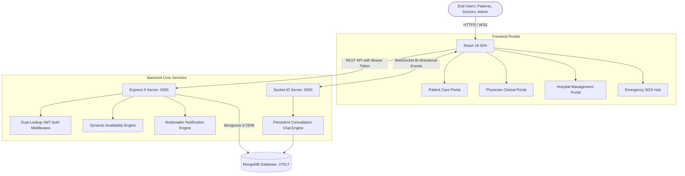

<div align="center">

# 🏥 Smart Hospital Management & Telemedicine System

[](https://reactjs.org/)
[](https://nodejs.org/)
[](https://expressjs.com/)
[](https://www.mongodb.com/)
[](https://socket.io/)
[](https://jwt.io/)
[](https://opensource.org/licenses/MIT)

<p align="center">
  <b>A state-of-the-art healthcare web application uniting Patients, Physicians, Hospital Administration, Real-time Telemedicine, and AI-Powered Triage in a single platform.</b>
</p>

[Explore Portals](#-portals--features) • [Quick Start](#-quick-start) • [Demo Logins](#-demo-credentials) • [API Docs](#-api-endpoints) • [Architecture](#-architecture)

</div>

---

## 📌 Overview

The **Smart Hospital Management & Telemedicine System** is an enterprise-ready digital healthcare solution. It streamlines clinical workflows, automates appointment scheduling with intelligent slot calculation, manages ward occupancy and pharmacy inventory in real time, and facilitates virtual consultations with persistent medical records.

### 🌟 Key Features
- **🤖 AI Symptom Checker**: Multi-system rule-based symptom assessment with immediate triage severity scoring and doctor specialization matching.
- **📅 Smart Slot Engine**: Automatically calculates vacant 30-minute intervals from physician schedules and prevents double-booking.
- **💬 Real-Time Telemedicine**: Low-latency consultation chat and telemedicine rooms powered by Socket.IO with MongoDB message persistence.
- **🏥 Ward & Bed Operations**: Live bed board tracking across ICU, Emergency, General, Maternity, Pediatric, and Surgical wards.
- **💊 Pharmacy Stock Control**: Real-time batch counts, expiry date trackers, and minimum threshold alerts.
- **💳 Financial Billing & Receipts**: Itemized medical invoice generation, tax & discount calculation, and online payment settlement.
- **🚀 Zero-Configuration Seeding**: Pre-seeded demo doctors, hospital administrators, patients, ward beds, medicines, and sample invoices upon first launch.

---

## 🏛️ Architecture



---

## 🔑 Demo Credentials

Test the complete application instantly using the pre-configured accounts:

| Portal | Email | Password | Role & Permissions |
| :--- | :--- | :--- | :--- |
| 🧑‍🤝‍🧑 **Patient** | `vv88610705@gmail.com` | `123456` | Book appointments, AI triage, view Rx & invoices |
| 🧑‍🤝‍🧑 **Patient (Alias)** | `patient@gmail.com` | `123456` | Secondary patient profile with demo records |
| 🩺 **Doctor** | `doctor@gmail.com` | `123456` | Consult queue, e-prescriptions, schedule & fee control |
| 🏢 **Hospital Admin** | `management@gmail.com` | `123456` | Doctor hiring, ward bed tracking, pharmacy & revenue |

> 💡 **Quick Fill**: Click the **"Fill Demo Details"** button on the `/login` screen to autofill any role credentials with one click.

---

## 💻 Portals & Features

### 🧑‍🤝‍🧑 1. Patient Care Portal (`/patient/dashboard`)
- **Full-Width Workspace with Left-Sidebar Navigation**:
  1. **AI Symptom Checker**: Multi-body system questionnaire calculating triage severity (Mild, Moderate, High, Severe).
  2. **Book Appointment**: Filter doctors by specialty, view consulting fees & room numbers, and select real-time vacant slots.
  3. **Appointment History**: Track status badges (`PENDING`, `APPROVED`, `COMPLETED`, `CANCELLED`, `REJECTED`).
  4. **My Prescriptions**: Access digital doctor prescriptions with exact dosage (`1-0-1`), duration, and dietary directions.
  5. **Medical Reports**: Secure vault to store and view lab tests and clinical documents.
  6. **Billing & Invoices**: Itemized bills with one-click payment receipts via UPI/Net Banking.

### 🩺 2. Physician Clinical Portal (`/doctor/dashboard`)
- **Patient Queue**: Live incoming consultation requests with instant action buttons (Approve, Reschedule, Reject).
- **E-Prescription Builder**: Issue digital prescriptions linking pharmacy inventory medications, diagnosis, and notes.
- **Availability & Pricing Control**: Configure active days (Mon–Sat), daily working hours (`09:00 - 17:00`), slot duration (30 mins), and consultation fee (`₹500`).
- **Telemedicine Suite**: Direct real-time virtual room for remote patient care.

### 🏢 3. Hospital Management Portal (`/management/dashboard`)
- **Medical Staff Directory**: Comprehensive doctor roster, specialization distribution, and new doctor onboarding.
- **Ward & Bed Allocator**: Live tracking of 6 specialized wards:
  - `ICU`, `General Ward`, `Emergency Care`, `Maternity`, `Pediatric`, and `Surgical Ward`.
  - Status management: `Available`, `Occupied`, `Maintenance`, `Cleaning`.
- **Pharmacy & Drug Inventory**: Real-time stock counts, batch numbers, and expiry alerts.
- **Financial Analytics & Revenue**: Total hospital revenue, paid collections, pending receivables, and itemized billing generator.

### 🚨 4. Emergency SOS Hub (`/emergency`)
- Direct unauthenticated access for emergency ambulance dispatch, 24/7 blood bank, and casualty desk contacts.

---

## 🛠️ Tech Stack Details

| Domain | Technology | Description |
| :--- | :--- | :--- |
| **Frontend Core** | React 18 (`react`, `react-dom`) | Component-based interactive UI |
| **Routing** | React Router v6 | Client-side routing with role-protected route guards |
| **Styling** | Modern Vanilla CSS | Custom design tokens, glassmorphism, responsive sidebar |
| **Icons** | React Icons (`react-icons/fa`) | High-clarity FontAwesome icons |
| **HTTP Client** | Axios (`axios`) | Configured with token interceptors and 401 recovery |
| **Backend Core** | Node.js + Express v5 | RESTful API server |
| **Database** | MongoDB + Mongoose v8 | Schemas for 12 hospital entities |
| **WebSockets** | Socket.IO v4.8 | Low-latency chat synchronization & room management |
| **Security** | JSON Web Tokens + BCrypt | 24-hour bearer tokens with encrypted password hashing |

---

## 🔌 API Endpoints

### Authentication
- `POST /api/auth/register` - Create patient, doctor, or management account
- `POST /api/auth/login` - Authenticate credentials and receive 24h JWT

### Clinical & Appointments
- `GET /api/doctors` - Retrieve doctors catalog (Management)
- `GET /api/doctors/:id/available-slots` - Compute available booking slots for a date
- `PUT /api/doctors/profile` - Update doctor schedule, fee, and room number
- `POST /api/appointments` - Book a new consultation appointment
- `GET /api/appointments/patient` - Patient appointments list
- `GET /api/appointments/doctor` - Doctor incoming queue
- `PATCH /api/appointments/:id/status` - Update consultation status

### Hospital Operations
- `GET /api/beds` - Retrieve ward beds with availability metrics
- `POST /api/beds` - Register a new hospital bed
- `PUT /api/beds/:id` - Update bed occupancy status
- `GET /api/medicines` - Pharmacy drug stock levels
- `POST /api/medicines` - Add or restock medicine batch
- `GET /api/invoices` - Hospital financial revenue & invoice registry
- `PUT /api/invoices/:id/pay` - Settle invoice with online payment

---

## 🚀 Quick Start

### 1. Prerequisites
- **Node.js**: v18 or higher ([Download](https://nodejs.org/))
- **MongoDB**: Local MongoDB instance (`mongodb://127.0.0.1:27017`) or [MongoDB Atlas URI](https://cloud.mongodb.com/)

### 2. Clone the Repository
```bash
git clone https://github.com/shashank/Smart-Hospital-System.git
cd Smart-Hospital-System
```

### 3. Setup and Run Backend
```bash
cd backend
npm install
npm start
```
*Backend runs on `http://localhost:5000` and automatically populates demo data on startup.*

### 4. Setup and Run Frontend
Open a new terminal window:
```bash
cd frontend
npm install
npm start
```
*Frontend opens automatically in your browser at `http://localhost:3000`.*

---

## ⚙️ Environment Variables

Create a `.env` file inside the `backend/` folder:

```env
PORT=5000
MONGODB_URI=mongodb://127.0.0.1:27017/Smart-Hospital-System
JWT_SECRET=smart_hospital_secret_key_2026_super_secure
NODE_ENV=development

# Optional SMTP Settings (simulation mode active if blank)
EMAIL_USER=
EMAIL_PASSWORD=
```

---

## 📂 Project Structure

```text
Smart-Hospital-System/
├── backend/
│   ├── middleware/        # JWT auth & role validation middleware
│   ├── models/            # Mongoose schemas (User, Doctor, Bed, Invoice, etc.)
│   ├── routes/            # Express routes (auth, doctors, appointments, beds, invoices)
│   ├── utils/             # Demo accounts seeder & notification services
│   ├── server.js          # Express app & Socket.IO server
│   └── package.json
├── frontend/
│   ├── public/            # HTML5 shell
│   ├── src/
│   │   ├── api/           # Axios client with bearer token interceptors
│   │   ├── components/    # Modular React components by domain:
│   │   │   ├── ai/        # AI Symptom Checker & triage
│   │   │   ├── appointments/ # Dynamic slot picker & history
│   │   │   ├── auth/      # Multi-portal login & register
│   │   │   ├── beds/      # Ward bed live tracker
│   │   │   ├── billing/   # Itemized invoice & payment receipt
│   │   │   ├── dashboard/ # Patient, Doctor, and Management portals
│   │   │   ├── prescriptions/ # Digital Rx manager
│   │   │   ├── reports/   # Diagnostic records vault
│   │   │   └── telemedicine/ # Socket.IO consultation room
│   │   ├── context/       # Toast notification provider
│   │   ├── App.jsx        # Route definitions & guards
│   │   └── index.css      # Design system & responsive layout styles
│   └── package.json
├── README.md              # GitHub repository documentation
└── shashank.md            # Complete project architectural reference
```

---

## 🤝 Contributing

Contributions are welcome! Please follow these steps:
1. Fork the project repository.
2. Create your feature branch (`git checkout -b feature/AmazingFeature`).
3. Commit your changes (`git commit -m 'Add AmazingFeature'`).
4. Push to the branch (`git push origin feature/AmazingFeature`).
5. Open a Pull Request.

---

## 📄 License

This project is open-source and distributed under the **MIT License**. See `LICENSE` for details.

---

<div align="center">
  <b>Designed & Developed by Shashank</b><br>
  <sub>Smart Hospital Management & Telemedicine System © 2026</sub>
</div>
