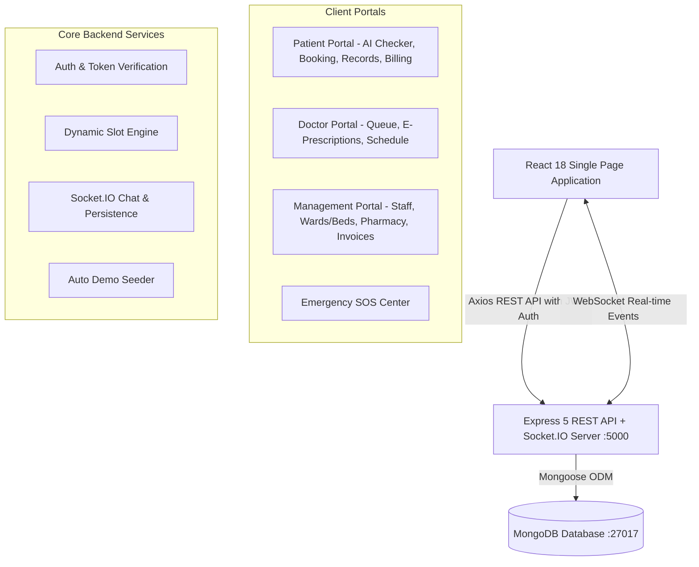

# 🏥 Smart Hospital Management & Telemedicine System

> **A modern, full-stack healthcare ecosystem integrating Patient Care, Physician Clinical Workflows, Hospital Administration, Real-time Telemedicine, and AI-Powered Symptom Triage.**

---

## 📑 Table of Contents
1. [Project Overview](#-project-overview)
2. [Key Highlights & Architecture](#-key-highlights--architecture)
3. [Technology Stack](#-technology-stack)
4. [User Roles & Portals](#-user-roles--portals)
   - [1. Patient Care Portal](#1-patient-care-portal)
   - [2. Physician Clinical Portal](#2-physician-clinical-portal)
   - [3. Hospital Management Portal](#3-hospital-management-portal)
   - [4. Emergency & SOS Response](#4-emergency--sos-response)
5. [Demo Credentials & Quick Login](#-demo-credentials--quick-login)
6. [Database Models & Architecture](#-database-models--architecture)
7. [API Endpoints Reference](#-api-endpoints-reference)
8. [Real-time Telemedicine & WebSockets](#-real-time-telemedicine--websockets)
9. [Project Directory Structure](#-project-directory-structure)
10. [Installation & Setup Guide](#-installation--setup-guide)
11. [Environment Variables](#-environment-variables)
12. [Troubleshooting & FAQs](#-troubleshooting--faqs)

---

## 🌟 Project Overview

The **Smart Hospital Management System** is an enterprise-grade web application tailored for modern healthcare providers. It unifies hospital administration, clinical practice, and patient engagement into a single, cohesive, role-driven platform. 

The application resolves typical operational bottlenecks in healthcare by providing:
- **Zero-Wait Scheduling**: Dynamic doctor slot generation based on physician availability and existing bookings.
- **AI-Powered Health Triage**: Immediate rule-based symptom assessment with severity scoring and recommended doctor specializations.
- **Unified Hospital Operations**: Live bed tracking across specialized wards, real-time pharmacy stock monitoring, and financial revenue tracking.
- **Virtual Healthcare Access**: Integrated Socket.IO chat and consultation rooms with chat persistence.
- **Automated Data Seeding**: Out-of-the-box demo accounts, ward beds, pharmacy inventory, and billing invoices ready upon launch.

---

## 🏛️ Key Highlights & Architecture



---

## 🛠️ Technology Stack

### Frontend
- **Framework**: React 18 (`react`, `react-dom`)
- **Routing**: React Router DOM v6
- **Styling**: Modular Vanilla CSS with responsive design, glassmorphism, and color-coded role themes
- **Icons**: React Icons (`fa` FontAwesome library)
- **HTTP Client**: Axios with automatic JWT interceptors and session error handling
- **Real-time Client**: `socket.io-client` v4.8

### Backend
- **Runtime**: Node.js (v18+)
- **Web Framework**: Express v5
- **Database Engine**: MongoDB with Mongoose v8 ODM
- **Real-time Communication**: `socket.io` v4.8
- **Authentication**: JSON Web Tokens (`jsonwebtoken`) & `bcryptjs` encryption
- **Email Service**: `nodemailer` (Simulation / SMTP mode)

---

## 👥 User Roles & Portals

### 1. Patient Care Portal
*Route: `/patient/dashboard`*

The patient dashboard features a full-screen layout with an interactive left-sidebar navigation and top-level KPI health metrics:
- **Top KPI Metrics Bar**: Displays total consultations, upcoming appointments, pending prescriptions, and outstanding invoices.
- **AI Symptom Checker**: 
  - Interactive multi-system questionnaire (Cardiovascular, Respiratory, Gastrointestinal, Neurological, General).
  - Calculates symptom severity (Mild, Moderate, High, Severe).
  - Recommends the exact medical specialization needed and provides self-care guidance.
- **Book Appointment**:
  - Filter doctors by medical specialization (Cardiology, Neurology, Pediatrics, Orthopedics, General Medicine, Dermatology).
  - Live doctor profile cards with fees, experience, room numbers, and available working days.
  - Interactive calendar with dynamic slot generation (calculates vacant 30-minute intervals).
- **Appointment History**:
  - Chronological timeline of all consultations with status badges (`PENDING`, `APPROVED`, `COMPLETED`, `CANCELLED`, `REJECTED`).
  - One-click access to enter live telemedicine consult room.
- **My Prescriptions**:
  - Access verified digital prescriptions written by consulting physicians.
  - View medicine names, exact dosage, frequency (e.g. `1-0-1`), duration, and dietary directions.
- **Medical Reports Vault**:
  - Secure diagnostic reports storage with upload and viewing capabilities.
- **Billing & Invoices**:
  - Track hospital invoices with transparent itemized breakdowns (Consultation, Medicine, Lab Test, Bed Charges).
  - One-click online payment processing via simulated UPI/Net Banking with downloadable receipts.

---

### 2. Physician Clinical Portal
*Route: `/doctor/dashboard`*

Designed specifically for healthcare practitioners:
- **Queue Management**: Real-time listing of incoming patient consultations.
- **Appointment Actions**: Accept, reschedule, mark completed, or reject consultation requests.
- **E-Prescription Generator**:
  - Digital prescription builder allowing doctors to prescribe medicines directly from the pharmacy inventory.
  - Attach medical diagnosis notes, dosage instructions, and follow-up advice.
- **Schedule & Availability Manager**:
  - Set working hours (e.g., `09:00 - 17:00`), consultation slot duration (e.g., 30 mins), and consultation fee (`₹500`).
  - Toggle active practice days (Monday through Saturday).
- **Telemedicine Suite**: Direct video/chat room connection with the scheduled patient.

---

### 3. Hospital Management Portal
*Route: `/management/dashboard`*

Full-spectrum hospital administration center:
- **Hospital Staff Management**:
  - View all registered physicians, their specializations, experience, room numbers, and contact numbers.
  - Form to onboard new physicians with automated welcome notifications.
- **Bed & Ward Management**:
  - Live occupancy board covering: `ICU`, `General Ward`, `Emergency Care`, `Maternity`, `Pediatric`, and `Surgical Ward`.
  - Filter beds by status (`Available`, `Occupied`, `Maintenance`, `Cleaning`).
  - Admit patients, assign bed numbers, and track daily ward rates.
- **Pharmacy Inventory Control**:
  - Real-time stock counts, minimum batch alerts, and expiry date monitoring.
  - Add and update drug batches with zero paperwork.
- **Financial Analytics & Invoices**:
  - Financial summary: Total hospital revenue, paid invoices, pending balances, and total transactions.
  - Issue itemized bills with tax and discount calculators.

---

### 4. Emergency & SOS Response
*Route: `/emergency`*

- One-tap quick response center accessible without requiring prior login.
- Emergency ambulance dispatch, hospital casualty line, 24/7 blood bank, and ICU desk contacts.

---

## 🔑 Demo Credentials & Quick Login

The application comes pre-loaded with automated demo accounts. You can type them manually or click the **"Fill Demo Details"** button on the `/login` screen:

| Role | Email | Password | Pre-configured Profile |
| :--- | :--- | :--- | :--- |
| 🧑‍🤝‍🧑 **Patient** | `vv88610705@gmail.com` | `123456` | John Doe (Blood Group: B+, Age: 29) |
| 🧑‍🤝‍🧑 **Patient (Alias)** | `patient@gmail.com` | `123456` | Demo Patient (Blood Group: O+, Age: 26) |
| 🩺 **Doctor** | `doctor@gmail.com` | `123456` | Dr. Sarah Jenkins (General Medicine, 8 Yrs Exp) |
| 🏢 **Hospital Admin** | `management@gmail.com` | `123456` | Apex Hospital Administration |

> **Note**: Custom registration is also supported for all 3 roles on the `/register` page with real-time validation.

---

## 🗄️ Database Models & Architecture

All schemas are managed using Mongoose in `backend/models/`:

1. **`User`**: Core identity collection storing name, email, hashed password, phone, gender, age, blood group, role (`patient`, `doctor`, `management`), and specialization.
2. **`Doctor`**: Detailed clinical profile including specialization, experience, consultation fee, available days, working hours, slot duration, and room number.
3. **`Patient`**: Dedicated patient medical record and baseline demographics.
4. **`Management`**: Hospital administrative access credentials and clearance levels.
5. **`Appointment`**: Consultation bookings linking patient, doctor, date, timeslot, reason, symptoms, notes, and lifecycle status (`PENDING`, `APPROVED`, `COMPLETED`, `CANCELLED`, `REJECTED`).
6. **`Prescription`**: Digital Rx linking patient, doctor, diagnosis, medicines array (name, dosage, frequency, duration), and clinical notes.
7. **`Medicine`**: Pharmacy catalog tracking drug name, quantity in stock, and expiry date.
8. **`Bed`**: In-patient infrastructure model tracking bed number, ward type, floor, status, admitted patient name, and daily rate.
9. **`Invoice`**: Hospital billing records with itemized charge categories, subtotal, tax, discount, total amount, payment status, and payment method.
10. **`Message`**: Real-time consultation chat messages with room identifiers, timestamps, and persistent history.
11. **`Report`**: Laboratory test documents and diagnostic attachments.

---

## 🔌 API Endpoints Reference

### 🔐 Authentication (`/api/auth`)
| Method | Endpoint | Description | Access |
| :--- | :--- | :--- | :--- |
| `POST` | `/api/auth/register` | Register a new patient, doctor, or management account | Public |
| `POST` | `/api/auth/login` | Authenticate user, verify password, and return JWT token | Public |

### 🩺 Doctors (`/api/doctors`)
| Method | Endpoint | Description | Access |
| :--- | :--- | :--- | :--- |
| `GET` | `/api/doctors` | List all doctors (with staff analytics) | Management |
| `POST` | `/api/doctors` | Add a new doctor to the hospital registry | Management |
| `GET` | `/api/doctors/profile` | Retrieve authenticated doctor's profile | Doctor |
| `PUT` | `/api/doctors/profile` | Update schedule, fees, room, and working hours | Doctor |
| `GET` | `/api/doctors/:id/available-slots` | Calculate real-time available booking intervals for date | Public / Patient |

### 📅 Appointments (`/api/appointments`)
| Method | Endpoint | Description | Access |
| :--- | :--- | :--- | :--- |
| `POST` | `/api/appointments` | Book a new consultation appointment | Patient |
| `GET` | `/api/appointments/patient` | Get authenticated patient's appointments | Patient |
| `GET` | `/api/appointments/doctor` | Get authenticated doctor's incoming queue | Doctor |
| `PATCH`| `/api/appointments/:id/status` | Update status (`APPROVED`, `COMPLETED`, etc.) | Doctor |

### 💊 Prescriptions (`/api/prescriptions`)
| Method | Endpoint | Description | Access |
| :--- | :--- | :--- | :--- |
| `POST` | `/api/prescriptions` | Create and issue an e-prescription | Doctor |
| `GET` | `/api/prescriptions/patient` | Retrieve patient's digital prescriptions | Patient |
| `GET` | `/api/prescriptions/doctor` | Retrieve all prescriptions issued by doctor | Doctor |

### 🏥 Ward Beds (`/api/beds`)
| Method | Endpoint | Description | Access |
| :--- | :--- | :--- | :--- |
| `GET` | `/api/beds` | Retrieve all beds with ward statistics | Management |
| `POST` | `/api/beds` | Add a new bed unit | Management |
| `PUT` | `/api/beds/:id` | Update bed occupancy or maintenance status | Management |
| `DELETE`| `/api/beds/:id` | Remove a bed record | Management |

### 📦 Pharmacy (`/api/medicines`)
| Method | Endpoint | Description | Access |
| :--- | :--- | :--- | :--- |
| `GET` | `/api/medicines` | Get list of medicines in stock | Authenticated |
| `POST` | `/api/medicines` | Add or update medicine stock | Management |
| `DELETE`| `/api/medicines/:id` | Delete medicine from inventory | Management |

### 💵 Invoices & Billing (`/api/invoices`)
| Method | Endpoint | Description | Access |
| :--- | :--- | :--- | :--- |
| `GET` | `/api/invoices` | Get all invoices and financial revenue stats | Management |
| `GET` | `/api/invoices/my-invoices` | Get personal medical invoices | Patient |
| `POST` | `/api/invoices` | Create a new itemized hospital bill | Management |
| `PUT` | `/api/invoices/:id/pay` | Settle invoice with online payment | Patient / Management |

### 💬 Telemedicine Chat (`/api/messages`)
| Method | Endpoint | Description | Access |
| :--- | :--- | :--- | :--- |
| `GET` | `/api/messages/:room` | Fetch archived chat history for consultation room | Authenticated |

---

## ⚡ Real-time Telemedicine & WebSockets

The system utilizes Socket.IO for live interaction between patients and physicians:
1. **Room-based Architecture**: Each appointment has a unique consultation room (`room_${appointmentId}`).
2. **Event Lifecycle**:
   - `joinRoom`: Joins client socket to the appointment channel and streams the last 100 historical messages.
   - `sendMessage`: Broadcasts new messages in real-time and persists them asynchronously to MongoDB.
   - `receiveMessage`: Delivers messages instantaneously to the peer client with sender role indicators.

---

## 📁 Project Directory Structure

```text
Smart-Hospital-System/
├── backend/
│   ├── middleware/
│   │   └── auth.js               # JWT verification & role clearance middleware
│   ├── models/
│   │   ├── Appointment.js        # Consultation bookings schema
│   │   ├── Bed.js                # Hospital ward beds schema
│   │   ├── Doctor.js             # Doctor profile and schedule schema
│   │   ├── Invoice.js            # Billing and financial invoice schema
│   │   ├── Management.js         # Administration credentials schema
│   │   ├── Medicine.js           # Pharmacy inventory schema
│   │   ├── Message.js            # Telemedicine chat persistence schema
│   │   ├── Patient.js            # Patient profile schema
│   │   ├── Prescription.js       # E-prescription Rx schema
│   │   ├── Report.js             # Diagnostic reports schema
│   │   └── User.js               # Universal authentication user model
│   ├── routes/
│   │   ├── appointments.js       # Appointment management endpoints
│   │   ├── auth.js               # Registration & login endpoints
│   │   ├── beds.js               # Ward beds CRUD endpoints
│   │   ├── doctors.js            # Doctor profiles & slot generator
│   │   ├── invoices.js           # Financial billing endpoints
│   │   ├── medicines.js          # Pharmacy stock endpoints
│   │   ├── messages.js           # Message history endpoints
│   │   ├── patients.js           # Patient health records endpoints
│   │   ├── prescriptions.js      # E-prescriptions endpoints
│   │   └── reports.js            # Medical report upload endpoints
│   ├── utils/
│   │   ├── emailService.js       # Automated notification utility
│   │   └── initDemoAccounts.js   # Automated startup seeder for demo accounts & data
│   ├── server.js                 # Express app & Socket.IO server entry point
│   ├── package.json              # Backend dependencies
│   └── .env                      # Environment configuration
│
└── frontend/
    ├── public/
    │   └── index.html            # Web application HTML5 shell
    ├── src/
    │   ├── api/
    │   │   └── client.js         # Central Axios client with token interceptor
    │   ├── components/
    │   │   ├── ai/
    │   │   │   └── AISymptomChecker.jsx      # AI triage and symptom assessment
    │   │   ├── appointments/
    │   │   │   ├── AppointmentBooking.jsx    # Doctor selection & slot picker
    │   │   │   ├── AppointmentHistory.jsx    # Consultation lifecycle tracker
    │   │   │   └── DoctorScheduleManager.jsx # Doctor working hours configuration
    │   │   ├── auth/
    │   │   │   ├── Login.jsx                 # Role-selector login with demo autofill
    │   │   │   └── Register.jsx              # Multi-role patient/doctor registration
    │   │   ├── beds/
    │   │   │   └── BedManagement.jsx         # Live ward bed tracking board
    │   │   ├── billing/
    │   │   │   └── BillingView.jsx           # Invoice generation and UPI payment
    │   │   ├── dashboard/
    │   │   │   ├── PatientDashboard.jsx      # Full-width 6-feature patient layout
    │   │   │   ├── DoctorDashboard.jsx       # Doctor clinical workflow dashboard
    │   │   │   ├── ManagementDashboard.jsx   # Hospital administration suite
    │   │   │   ├── MedicineInventory.jsx     # Pharmacy stock management
    │   │   │   └── EmergencyDashboard.jsx    # SOS response helpline
    │   │   ├── prescriptions/
    │   │   │   ├── DoctorPrescriptionManager.jsx # Prescription creation interface
    │   │   │   └── PatientPrescriptions.jsx  # Patient prescription viewer
    │   │   ├── reports/
    │   │   │   └── PatientReports.jsx        # Diagnostic reports vault
    │   │   ├── telemedicine/
    │   │   │   └── TelemedicineRoom.jsx      # Real-time consultation chat room
    │   │   └── layout/
    │   │       └── Navbar.jsx                # Global navigation bar
    │   ├── context/
    │   │   └── ToastContext.jsx              # Interactive toast notification context
    │   ├── App.jsx                           # Primary router & authentication gates
    │   ├── index.js                          # React root initialization
    │   └── index.css                         # Global CSS styles & design tokens
    └── package.json                          # Frontend dependencies
```

---

## 🚀 Installation & Setup Guide

### Prerequisites
1. **Node.js**: v18.0.0 or higher ([Download Node.js](https://nodejs.org/))
2. **MongoDB**: Local MongoDB instance running on port 27017, or a [MongoDB Atlas](https://www.mongodb.com/cloud/atlas) cloud URI.

### Step 1: Clone the Repository
```bash
git clone https://github.com/shashank/Smart-Hospital-System.git
cd Smart-Hospital-System
```

### Step 2: Backend Configuration & Startup
```bash
# Navigate to backend directory
cd backend

# Install dependencies
npm install

# Start the server (with automatic database seeding)
npm start
```
*The backend will boot on `http://localhost:5000` and automatically seed demo accounts and sample hospital data if missing.*

### Step 3: Frontend Setup & Startup
Open a new terminal window:
```bash
# Navigate to frontend directory
cd frontend

# Install dependencies
npm install

# Start the React development server
npm start
```
*The web browser will launch `http://localhost:3000` with hot-reloading enabled.*

---

## ⚙️ Environment Variables

### Backend (`backend/.env`)
```env
PORT=5000
MONGODB_URI=mongodb://127.0.0.1:27017/Smart-Hospital-System
JWT_SECRET=smart_hospital_secret_key_2026_super_secure
NODE_ENV=development

# Optional SMTP Settings (defaults to simulation mode if empty)
EMAIL_USER=
EMAIL_PASSWORD=
```

### Frontend (`frontend/.env` - Optional)
```env
REACT_APP_API_URL=http://localhost:5000
```

---

## ❓ Troubleshooting & FAQs

### 1. Why was I receiving `401 Unauthorized` on `/management/dashboard`?
In prior builds, token decoding only looked up management users in the dedicated `Management` collection rather than falling back to the `User` collection. This has been resolved in `backend/middleware/auth.js` and `backend/routes/auth.js` by introducing synchronized cross-collection lookups and auto-creation of management profiles.

### 2. Can I use MongoDB Atlas instead of local MongoDB?
Yes. Simply change `MONGODB_URI` in `backend/.env` to your cloud connection string:
```env
MONGODB_URI=mongodb+srv://<username>:<password>@cluster0.mongodb.net/Smart-Hospital-System?retryWrites=true&w=majority
```

### 3. How does the dynamic slot calculation work?
When a patient picks a date for an appointment, `GET /api/doctors/:id/available-slots` computes the doctor's working hours, segments them into 30-minute intervals, compares them against all booked appointments for that day, and returns only unbooked time slots.

---

<p align="center">
  <b>Developed by Shashank</b><br>
  <i>Smart Hospital Management & Telemedicine System © 2026</i>
</p>
